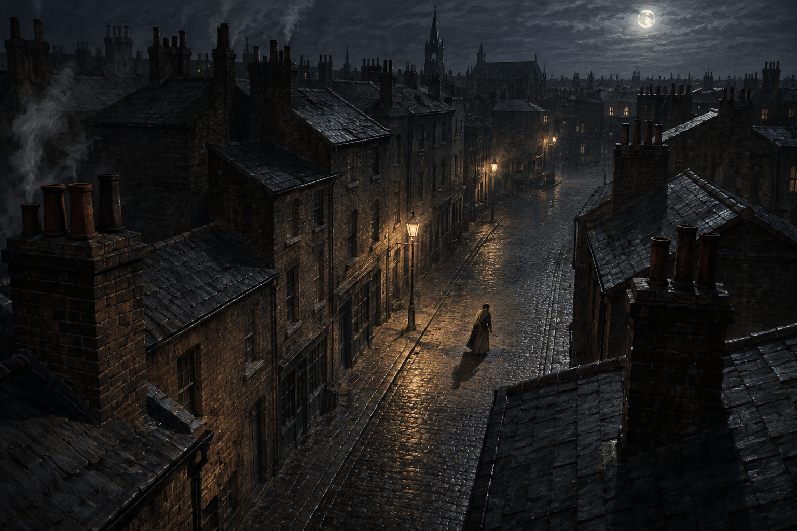

# Four Pence for a Bed
<figure style="text-align: center;">
  </figure>

**Read the English version:** [Four Pence for a Bed — Chuck Lund](https://charlesslund.substack.com/p/four-pence-for-a-bed)
---

---

---
Restava pouco gim no copo.

Anne Chapman inclinou-o e observou as últimas gotas escorrerem pelo vidro. Estava sentada no pub havia quase uma hora, embora já não se lembrasse de quando entrara.

Alguém deixara um exemplar do The Times sobre a mesa. Sexta-feira, 7 de setembro de 1888. Ela leu a data duas vezes, sem saber por quê. Mais abaixo, uma notícia sobre o enterro de uma mulher assassinada em Whitechapel. Anne afastou o jornal.

Houve um tempo em que lia jornais por prazer.

Em Windsor, lembrou-se, havia um pequeno jardim. Seu marido trabalhava como cocheiro, e eles moravam numa casa de verdade, com cortinas nas janelas e lençóis limpos nas camas. Lembrava-se do cheiro de sabão. Estranho que se lembrasse do sabão, entre tantas coisas.
Naquele tempo, era a senhora Chapman.

Agora era Dark Annie.

Terminou o gim e olhou em volta. Dois homens discutiam junto ao balcão. Uma mulher ria, mostrando a falha deixada pela ausência dos dentes da frente. O proprietário enxugava copos com um pano encardido.

Anne procurou no bolso.

Quatro pence.

Contou as moedas novamente, embora soubesse perfeitamente quantas eram.

Uma cama na hospedaria custava oito pence. Tinha metade do dinheiro. Precisava de mais quatro.

Pediu uma caneca de porter, mas o proprietário recusou-se a servi-la sem pagamento.

Anne levantou-se.

Era uma noite clara de fim de verão. Não havia sequer um vestígio da proverbial neblina londrina.

Anne caminhou pela Dorset Street até a hospedaria. Ainda havia movimento na rua: homens que saíam dos pubs, mulheres encostadas às paredes, carroças que passavam fazendo estremecer as pedras do calçamento.

Mostrou as quatro moedas ao encarregado e perguntou se poderia pagar o restante pela manhã.

Ele recusou.

— Você conhece as regras, Annie.

Ela conhecia. Havia regras até para quem não tinha onde dormir.

Saiu novamente para a rua.

Seguiu pela Brushfield Street, na direção da igreja de Christ Church. As janelas escuras das casas pareciam observar sua passagem. Um homem dormia sentado contra uma parede, com a cabeça apoiada nos joelhos. Mais adiante, uma mulher tentava fazer uma criança parar de chorar.

Anne desviou os olhos.

Vira aquelas coisas milhares de vezes. Naquela noite, porém, pareciam ofendê-la, como se as visse pela primeira vez. As janelas imundas, as sarjetas transbordantes, os rostos pálidos de crianças que deveriam estar dormindo. Até as casas pareciam exaustas. Sentiu-se humilhada pertencer ao local como se fosse parte da mobília.

Na Commercial Street, uma mulher mais jovem conversava com um cavalheiro de casaco escuro. Ele disse alguma coisa. Ela riu. Os dois desapareceram numa passagem estreita.

Anne perguntou-se quanto ele pagaria.

Quatro pence bastariam.

Continuou andando.

Perto de Spital Square, avistou um homem que vinha sozinho na direção contrária. Usava um bom casaco e caminhava sem pressa.
Anne ajeitou o vestido, alisou os cabelos e ensaiou um sorriso.

— Procurando companhia, senhor?

O homem diminuiu o passo.

Examinou-a de alto a baixo. Seu olhar deteve-se no rosto envelhecido, nas roupas gastas, nos sapatos deformados.

—  Não sua.

Fez uma expressão de repugnância e continuou andando.

Anne permaneceu imóvel por alguns instantes.

Não era a primeira vez que um homem a recusava. Mas havia alguma coisa naquele olhar que a ferira mais do que uma ofensa. Ele a examinara como se examina uma mercadoria estragada.

Ela baixou os olhos para o vestido que acabara de ajeitar.

Depois continuou andando.

As ruas se sucediam umas às outras. Anne entrou por Artillery Lane, passou diante de lojas fechadas e atravessou passagens tão estreitas que as paredes pareciam inclinar-se sobre sua cabeça.
Conhecia aquele bairro havia anos. Ainda assim, por vezes tinha a impressão de estar andando em círculos. As ruas desembocavam em outras ruas, as esquinas se repetiam, e cada caminho parecia conduzi-la de volta ao mesmo lugar.

Passou por uma igreja de portas trancadas.

Um relógio bateu em algum lugar, mas ela não conseguiu contar as badaladas.

Estava cansada.

Doíam-lhe os pés. Tinha o estômago vazio. O gim a aquecera durante algum tempo, mas o calor desaparecera.

Pensou nos lençóis limpos de Windsor.

Depois ouviu passos.

Vinham de trás, lentos e regulares.

Anne parou.

Os passos continuaram por um instante e também cessaram.

Ela se virou.

Não havia ninguém.

Talvez algum cavalheiro a tivesse visto e mudado de ideia. Aguardou, na esperança de que ele se aproximasse.

Em vez disso, ouviu os passos se afastarem.

— Senhor?

Não houve resposta.

Seguiu o som até a esquina e entrou em outra rua. Acelerou o passo, mas o desconhecido parecia permanecer sempre adiante, depois da próxima curva, além da próxima passagem.

Finalmente parou.

O ruído cessou também.

Por um instante, ocorreu-lhe que talvez estivesse seguindo um fantasma.

Ouvira muitas histórias de fantasmas. O East End estava cheio deles, se acreditássemos nas velhas das hospedarias.

Mas de que lhe serviria um fantasma?

Os mortos não tinham dinheiro.

Anne quase riu.

Ergueu a saia o suficiente para retirar um pequeno frasco de gim preso à liga. Ainda restava um pouco. Bebeu, limpou a boca com as costas da mão e guardou o frasco.

Quatro pence.

Seria realmente pedir tanto?

Os passos recomeçaram.

Dessa vez, vinham em sua direção.

Anne estava numa rua estreita, iluminada por um lampião a gás. A luz alcançava as fachadas de tijolos e uma fileira de portas fechadas. 

Mais adiante, a rua mergulhava na escuridão.

Um homem surgiu na extremidade iluminada.

Parou por um instante e olhou para ela.

Anne não ajeitou o vestido. Não sorriu.

Sentiu a aversão de sempre subir-lhe pela garganta. Mais um estranho. Mais um par de mãos. Mais alguns minutos fingindo que aquilo a agradava.

Houve um tempo em que fora uma mulher respeitável.

Perguntou-se se Deus ainda se lembrava disso.

O homem começou a se aproximar.

Anne pensou na hospedaria, na cama que não podia pagar, nas ruas pelas quais continuaria andando até o amanhecer. Pensou no homem que a examinara com desprezo. Na mulher que ria no pub, mostrando a boca desdentada. Nos lençóis limpos de Windsor.

Estava tão cansada.

Queria uma cama. Um teto sobre a cabeça. Algumas horas de sono sem frio, sem fome, sem que ninguém a tocasse.
Meu Deus, pensou, por favor, libertai-me.

O homem levou a mão ao casaco.

Uma lâmina reluziu sob a luz do lampião.

Anne ergueu os olhos para o rosto dele. Havia neles um brilho de loucura.

Ela avançou em sua direção.

